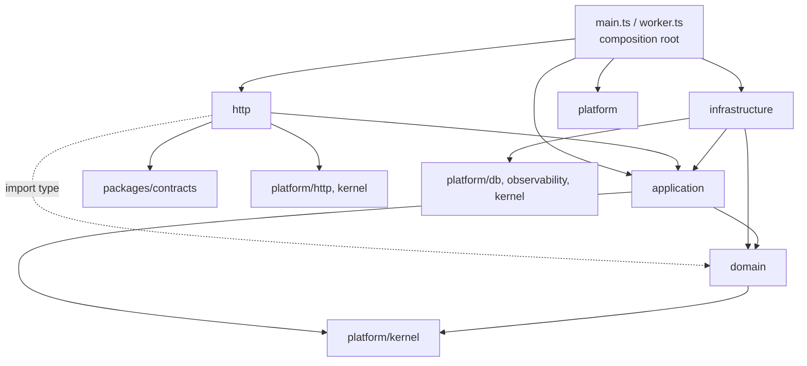

# Backend architecture (`apps/api`)

The API is a **modular monolith**. Each feature area is a module. Inside each module, code follows a ports-and-adapters (hexagonal / clean) layering. One process, one deployable, one database, with internal boundaries as strict as service boundaries.

These rules are binding. `dependency-cruiser` enforces the import rules in `pnpm verify`.

## 1. Folder structure

```text
apps/api/
  drizzle/                     SQL migrations (generated, committed)
  src/
    main.ts                    HTTP entry point: composition root
    worker.ts                  Job worker entry point: composition root
    migrate.ts                 One-shot migration entry point
    platform/                  Technical building blocks, no business rules
      config/                  Env schema (zod), instance config loading
      http/                    App factory, middleware, problem responses, validation hook
      db/                      Drizzle client, transaction helper
      observability/           OpenTelemetry setup, logger
      kernel/                  Result, AppError base, Clock and IdGenerator ports
    modules/
      guild/
        domain/                Entities, value objects, domain errors, pure rules
        application/           Use cases, ports (interfaces), DTOs of the module
        infrastructure/        Adapters: Drizzle repositories, Battle.net client, job handlers
        http/                  Routes, request parsing, response mapping
        index.ts               The module's public API and its register function
      character/
      identity/
      ...
```

Today the composition root is `src/index.ts`. Shared HTTP, config, kernel, and observability already live under `src/platform/`. Feature modules land under `src/modules/` when they exist.

## 2. Layers and what they may import

Arrows point from the importer to what it may import. Nothing else is allowed.



| Layer (importer)       | May import                                                                                                                               | Must not import                                                                                     |
| ---------------------- | ---------------------------------------------------------------------------------------------------------------------------------------- | --------------------------------------------------------------------------------------------------- |
| `domain`               | Own module's `domain`, `platform/kernel`                                                                                                 | Anything else: no zod, no Hono, no Drizzle, no `fetch`, no `process`, no `Date.now()` (use `Clock`) |
| `application`          | Own `domain`, own `application`, `platform/kernel`, other modules' `index.ts` (public API only)                                          | `infrastructure`, `http`, `platform/db`, `platform/http`, Hono, Drizzle, Battle.net packages        |
| `infrastructure`       | Own `application` (to implement its ports), own `domain`, `platform/db`, `platform/observability`, `platform/kernel`, external libraries | `http`, other modules' internals                                                                    |
| `http`                 | Own `application`, `import type` from own `domain`, `packages/contracts`, `platform/http`, `platform/kernel`                             | `infrastructure`, Drizzle, Battle.net packages, other modules' internals                            |
| `platform/*`           | Other `platform/*` folders, external libraries                                                                                           | Any `modules/*`                                                                                     |
| `index.ts` (module)    | Everything inside its own module                                                                                                         | Other modules' internals                                                                            |
| `main.ts`, `worker.ts` | Everything                                                                                                                               | —                                                                                                   |

Rules that follow from the table:

- **Dependency inversion.** The application layer declares a port (an interface), for example `GuildRosterSource`. Infrastructure implements it (`BattleNetGuildRosterSource`). `main.ts` passes the implementation into the use case. The use case never knows Battle.net or Drizzle exist.
- **No framework in the core.** `domain` and `application` are plain TypeScript. They can be tested without a database, a server, or the network.
- **Modules meet only at `index.ts`.** A module exports use cases or a small facade, never repositories, tables, or Battle.net types. Module A never imports `modules/b/domain/...`.
- **No cycles** between modules. If two modules need each other, the shared part becomes its own module, or one side publishes an event.
- **Tables belong to a module.** Only the owning module's infrastructure touches its tables, including in joins.

## 3. What each layer contains

### 3.1 Domain

- Entities and value objects as `readonly` types plus pure functions, or small classes with private constructors and factory functions that validate invariants.
- Domain errors as a discriminated union of plain objects with a stable `code` (see [errors](errors.md)). No `throw` for expected outcomes.
- No I/O, no current time, no random IDs. Time and IDs come in as parameters, or the application layer supplies them through `Clock` and `IdGenerator`.

```ts
export type RankId = number & { readonly __brand: "RankId" };

export interface RosterMember {
  readonly characterId: number;
  readonly name: string;
  readonly level: number;
  readonly rankId: RankId;
}

export const isGuildMaster = (m: RosterMember): boolean => m.rankId === 0;
```

### 3.2 Application

- One use case per file, named by intent: `get-guild-roster.ts`, `link-user-characters.ts`.
- A use case is a function created from its dependencies, returning `Promise<Result<Output, ErrorUnion>>`:

```ts
export interface GuildRosterSource {
  fetchRoster(guild: GuildRef): Promise<Result<RosterSnapshot, UpstreamError>>;
}

export interface RosterCache {
  latest(guild: GuildRef): Promise<RosterSnapshot | undefined>;
  save(snapshot: RosterSnapshot): Promise<void>;
}

export const makeGetGuildRoster =
  (deps: {
    source: GuildRosterSource;
    cache: RosterCache;
    clock: Clock;
    maxAge: Duration;
  }) =>
  async (
    guild: GuildRef,
  ): Promise<Result<RosterView, GuildNotFound | UpstreamUnavailable>> => {
    /* read cache, refresh when stale, fall back to stale data on upstream failure */
  };
```

- Ports are named after what the use case needs, not after the technology (`RosterCache`, not `PostgresRosterRepository`).
- Transactions are a port too (`UnitOfWork`), so the use case decides the boundary and infrastructure implements it.
- Authorization decisions ("may this user edit guild notes?") live here, as explicit checks that return an `access.forbidden` error.

### 3.3 Infrastructure

- Drizzle schema and repositories for the module's tables. Map rows to domain types at the edge; Drizzle row types never leave infrastructure.
- Battle.net adapters built on `@blizzard-api/wow-forever` with `@blizzard-api/client`. They translate HTTP status codes into application errors (404 becomes `*.not_found`, 429 and 5xx become `upstream.unavailable`), and validate responses with zod before mapping.
- Job handlers (pg-boss) that call use cases. A job handler contains no business logic.

### 3.4 HTTP

- Routes per module under a module prefix: `/api/guild/...`, `/api/characters/...`, `/api/me`, `/auth/...`.
- Every request input (params, query, body) is validated with the zod schema from `packages/contracts`. Validation failures become a `400` problem with `errors[]` (see [errors](errors.md)).
- The handler calls exactly one use case, maps `ok` to the response schema from `packages/contracts`, and maps the error union to a problem. It contains no business rules and no database access.
- Responses are typed by the contract schema. The OpenAPI 3.1 document is generated from the same schemas (`@hono/zod-openapi`) and published at `/api/openapi.json` outside production.

### 3.5 Platform

- `config`: one zod env schema, parsed once at startup; the process exits with the list of missing or invalid keys (never their values).
- `http`: `createApp()`, request ID and trace middleware, security headers, the central `onError` / `notFound` handlers that produce problems.
- `db`: one Drizzle client and pool per process, closed on shutdown.
- `observability`: OpenTelemetry Node SDK started before anything else; pino logger with trace and span IDs on each line.
- `kernel`: `Result`, `ok`, `err`, the `AppError` shape, `Clock`, `IdGenerator`. Tiny, with no dependencies.

## 4. Composition root

`main.ts` is the only place that knows every concrete class. It:

1. Starts telemetry.
2. Parses env and the instance config. Fails fast on errors.
3. Creates the database pool, the Battle.net client, the logger, and the clock.
4. Builds each module with `register<Module>(app, deps)` from its `index.ts`.
5. Starts the server and installs the `SIGTERM`/`SIGINT` shutdown (stop accepting connections, finish in-flight requests, close the pool, flush telemetry, exit 0).

No module reads `process.env`. No module creates its own database pool or HTTP client.

## 5. HTTP conventions

- JSON bodies in `camelCase`. Timestamps as RFC 3339 strings in UTC (`2026-11-13T12:00:00Z`). Durations in seconds as numbers with a unit in the name (`ttlSeconds`).
- IDs are strings in the API, even when the source is numeric, so the frontend never does arithmetic on them.
- Lists use cursor pagination: `?limit=50&cursor=...` and a response `{ items, nextCursor }`. Small, bounded lists (the roster) may return everything.
- Methods and status codes follow RFC 9110: `GET` is safe and cacheable, `POST` creates or triggers, `PUT`/`PATCH` update, `DELETE` removes. `201` with `Location` on create, `204` when there is no body.
- Cached Battle.net reads send `Cache-Control` and an `ETag`, and include `fetchedAt` in the body so the UI can show freshness.
- No API version prefix while the only client is our own web app, deployed together with the API. If an external client appears, introduce `/api/v1` with a decision record.
- Health: `GET /health/live` (process is up) and `GET /health/ready` (database reachable, migrations applied). `GET /health` remains a live alias. Neither needs auth; neither leaks details.

## 6. Authentication and sessions

- `/auth/login` creates `state` (and PKCE verifier where Battle.net accepts it), stores it in a short-lived `HttpOnly` cookie, and redirects to Battle.net through `arctic`.
- `/auth/callback` checks `state`, exchanges the code server-side, reads the Battle.net user, upserts the user, creates a session, and sets `__Host-gh_session`.
- Session tokens are 32 random bytes. The database stores only their SHA-256 hash. Each request looks up the hash, enforces idle and absolute expiry, and slides the idle expiry.
- `/auth/logout` (`POST`) deletes the session and clears the cookie.
- An `authenticated` middleware puts `{ userId, sessionId }` into the Hono context. Use cases receive the user as a parameter; they never read cookies.

## 7. Errors

See [errors](errors.md). In short: domain and application return typed errors as values; infrastructure maps technical failures into them; HTTP maps them to RFC 9457 problems in one place. Unexpected exceptions become a generic `500` problem, are logged with the stack trace, and are recorded on the trace.

## 8. Logging and telemetry

- The shared signal, resource, privacy, sampling, and metric-cardinality contract is
  [observability](observability.md). This section adds API-specific rules.
- Logs are JSON lines through pino; operational code never uses `console.*`.
- OpenTelemetry's Pino instrumentation adds `trace_id`, `span_id`, and `trace_flags`; application
  code does not implement correlation itself. Every application log also names its module.
- Hono's `requestId`, `@hono/structured-logger`, and `@hono/otel` own request IDs, lifecycle
  timing, route-aware logs, and server spans. Request logs carry method, route pattern (not the raw
  URL with IDs), status, and duration.
- Never log tokens, cookies, `Authorization` headers, secrets, or full Battle.net responses. pino `redact` paths enforce this.
- Levels: `error` for failed requests (5xx) and failed jobs, `warn` for degraded behaviour (stale cache served, upstream retry), `info` for lifecycle events, `debug` for development only.
- OpenTelemetry starts before Hono and the Node HTTP server are imported. Auto-instrumentation
  covers HTTP in and out and, once present, Postgres. Use cases that matter get spans named
  `<module>.<use-case>`.
- `OTEL_EXPORTER_OTLP_ENDPOINT` enables OTLP traces and metrics. Without it, the API still emits
  correlated JSON logs and never retries a nonexistent collector.
- Startup, shutdown, and telemetry flush use the same logger. Health-probe request logs are
  `debug`, so the default production log does not fill with probes.

## 9. Testing

| Level       | What                                      | How                                                                 | Where                                    |
| ----------- | ----------------------------------------- | ------------------------------------------------------------------- | ---------------------------------------- |
| Unit        | Domain functions, use cases               | Vitest, in-memory fakes for ports, fixed `Clock`                    | `src/**/*.test.ts` next to the code      |
| HTTP        | Routes, validation, problem mapping, auth | `app.request()` in-process with fake use cases or fake ports        | `src/modules/*/http/*.test.ts`           |
| Integration | Drizzle repositories, migrations          | Testcontainers (`@testcontainers/postgresql`) against PostgreSQL 18 | `src/**/*.int.test.ts`                   |
| Adapter     | Battle.net adapter                        | MSW with recorded, anonymised fixtures from the real API            | `src/modules/*/infrastructure/*.test.ts` |
| End to end  | User journeys through web and API         | Playwright against the Aspire stack with the Battle.net stub        | `apps/web/e2e/`                          |

Rules:

- Every use case has unit tests for its success path and every error in its error union.
- Tests never call the real Battle.net API. Recording new fixtures is a manual, documented step.
- Integration tests run in CI (Docker is available on the runner). Locally they need Docker running.
- Tests use the public API of the layer under test, not its internals.

## 10. Code conventions

- TypeScript `strict`, `noUncheckedIndexedAccess`, `verbatimModuleSyntax`. No `any`, no non-null `!` without a comment saying why it holds.
- Named exports only. One barrel file per module (`index.ts`); no barrels elsewhere.
- File names in `kebab-case`. Types and interfaces in `PascalCase`, functions and variables in `camelCase`, constants that are configuration in `SCREAMING_SNAKE_CASE`.
- No TypeScript `enum`; use `as const` objects or string unions.
- zod is used at the edges (env, HTTP input, Battle.net responses, instance config). Inside the core, types are plain TypeScript.
- Comments explain constraints the code cannot show, nothing else.
