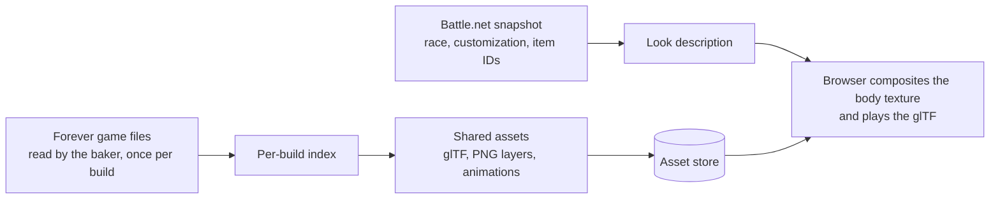

# Character rendering

How a guild character becomes an animated 3D model on the site. Decision: [0008](../decisions/0008-character-models-gltf.md).

Milestone A now has a manual fixed-look baker and a standalone viewer. It deliberately has no
Battle.net character integration, queue, or worker yet. Character pages continue to use the
official render image until milestone B connects their snapshots to this pipeline.

What we copy from Altrobe, what we leave, and the order to build it: [character rendering plan](character-rendering-plan.md).

## 1. No running game

A page view never starts World of Warcraft, never runs wowmodelviewer, and never runs wow.export.

| Thing                                                                           | Role                                                                                                                                                                                                                                                                                                                                                                                               |
| ------------------------------------------------------------------------------- | -------------------------------------------------------------------------------------------------------------------------------------------------------------------------------------------------------------------------------------------------------------------------------------------------------------------------------------------------------------------------------------------------- |
| Battle.net Profile API                                                          | The facts: race, gender, customization, equipped item IDs, and the official render image. Already cached as a character snapshot (north star §6, §7).                                                                                                                                                                                                                                              |
| Forever game files (product `wowf`)                                             | The 3D source: meshes, skeletons, animations, item models, textures, and the tables that map an item ID to a display. Owned by Blizzard. Not committed to the repo.                                                                                                                                                                                                                                |
| wow.export ([Kruithne/wow.export](https://github.com/Kruithne/wow.export), MIT) | The reference implementation. It reads those files, including product `wowf`, and can stream them from Blizzard's CDN with no local install (`casc-source-remote`). It exports M2 models to glTF with their animations, and it already composites a character texture from customization and gear. We study it and may use it by hand to prove a character once. It is not a service in our stack. |
| `apps/model-baker`                                                              | .NET bake tool, copied from Altrobe. Reads the game files once per build and writes glTF and PNG into the asset store.                                                                                                                                                                                                                                                                             |
| The browser                                                                     | Loads the cached glTF, textures, and a manifest from our own origin. Plays animations with Three.js.                                                                                                                                                                                                                                                                                               |

"From the Forever client" means from the game's data files, read while no game is running. The website only ever fetches files we already built and cached.

## 2. This has been done before

We are not the first to extract WoW models into a web renderer. The same shape already runs for Forever.

[Altrobe](https://github.com/Cloudmancermedia/altrobe) (MIT, active; the repo describes the public site [altrobe.com](https://altrobe.com)) is a dressing room for World of Warcraft: Forever:

```text
game files → importer (.NET, TACTSharp + DBCD) → glTF, PNG, JSON → React + three.js
```

Its hosted pipeline bakes a whole build from Blizzard's public CDN, with no game installed and nobody playing. The browser never parses M2. Assets are content-versioned (`v{N}/models/{fileId}.glb`), a `current.json` points at the build the site shows, and a failed bake keeps the previous build up. A scheduled job publishes a new bundle when Blizzard ships a build. The local app reads a Forever install on demand instead, through the same converter.

Older cousins, for other game lines:

| Project                                                                         | What it already does                                                                                                              |
| ------------------------------------------------------------------------------- | --------------------------------------------------------------------------------------------------------------------------------- |
| [wow.export](https://github.com/Kruithne/wow.export)                            | Exports M2 to glTF with animations, dresses characters, lists product `wowf`, streams from the CDN. Desktop tool.                 |
| [turtle-wow-model-viewer](https://github.com/JollyGrin/turtle-wow-model-viewer) | Extracts a 1.12 client into static files and renders race, gear, and animations with Three.js. `classic-wow-model-viewer` on npm. |
| [WebWowViewerCpp](https://github.com/Deamon87/WebWowViewerCpp)                  | Renders M2 and maps in WebGL in the browser. This is the viewer behind wow.tools. It parses game formats live, no glTF bake.      |
| wowmodelviewer                                                                  | The Windows desktop app we looked at. Not a web pipeline. GPL-3.0, so its code stays out of this repo.                            |

What none of them do is the guild site: take a real character from the Battle.net API (their face, their gear) and show that character, cached per look, next to the roster. Altrobe is a dressing room you dress by hand. It has no Armory import. That join, and the per-look cache in front of it, is the part that is ours.

The bake shape (CDN in, glTF out, immutable URLs, previous build kept on failure) is the one we follow. We do not re-derive it.

## 3. Why this shape

wowmodelviewer (GPL-3.0) is a Windows desktop program: C++ and Qt around an embedded Unity player that only talks to `127.0.0.1`. It reads a local install; Wowhead is used only to open an item from a Wowhead link. Porting it to the web means porting Unity, and its licence would cover our site. Running it as a sidecar still needs a desktop window on the server and still produces no model in the browser.

Embedding Wowhead's viewer (`viewer.min.js` from `wow.zamimg.com`, as the `wow-model-viewer` package does) gives animations quickly and ties the site to Wowhead's scripts, their CDN, and their terms. We do not do that.

The clean split is the one every current 3D web app uses:

- **Browser:** glTF 2.0, the Khronos standard for web models, played by Three.js (`AnimationMixer` for the skeleton animations). No M2 parser, no jQuery, no third-party script.
- **Server, off the request:** the slow conversion from WoW data to glTF, done once per result and cached.

Altrobe (§2) is the working proof of this split for Forever. Our pipeline follows that bake shape and adds the Armory join.

## 4. What is expensive

Measured nothing yet; the orders of magnitude are why the design looks like this. Budgets in §8 are the targets we build to.

| Work                                                           | How often it changes                               | Cost if done live                                                              |
| -------------------------------------------------------------- | -------------------------------------------------- | ------------------------------------------------------------------------------ |
| Battle.net character call                                      | Gear changes; we poll on a window                  | A network call under a limit of 100 requests/second and 36,000/hour per client |
| Item ID to display, model file, geosets, texture paths         | Once per Forever patch                             | Parsing DB2 tables out of the game files                                       |
| Extracting a mesh, an animation, or an item model              | Once per file per patch                            | Download from the CDN, decode BLP, parse M2                                    |
| Compositing the body texture (skin, face, hair, armor, tabard) | Every view, in the browser, from cached layer PNGs | Milliseconds on the GPU once the layers are downloaded. Not a server job.      |
| Loading the model in the browser                               | Every visit, unless cached                         | A few hundred kilobytes to a few megabytes                                     |

A roster of 16 characters shares the race meshes, the animations, the item models, and the texture layers. Those are extracted once. A look is only the list of which layers and parts to use. The browser composites the body texture.

## 5. Pipeline



The baker runs off the request. The API process never converts a file. The browser composites.

1. **Index a build.** Resolve the current `wowf` build, read the tables, and write the index (item ID to display, model file, geosets, texture layers). One index per build.
2. **Convert shared assets.** Export the race bodies, their animations, and each item display the roster actually uses to glTF. Decode each BLP texture to PNG. Keyed by build, converter version, and file ID.
3. **Describe the look.** Customization choices and equipped items become the geosets to show and the texture layers to paint. This is data, not an image.
4. **Composite in the browser** from those layers, then attach the item models and play the animation.

A **look hash** is a hash of `clientBuild + race + gender + customization choices + equipped item IDs sorted by slot`. It names which assets must be present. It is not a baked image. Two characters in identical gear share every file.

## 6. Cache

Six layers. A page view should hit layers 1 to 3 and never reach 5 or 6.

| Layer | Where                                         | Key                                 | Lifetime                    | Holds                                                                                            |
| ----- | --------------------------------------------- | ----------------------------------- | --------------------------- | ------------------------------------------------------------------------------------------------ |
| 1     | Browser HTTP cache                            | URL                                 | 1 year, `immutable`         | glTF, textures, manifests                                                                        |
| 2     | Caddy                                         | URL                                 | same `Cache-Control`        | the same files                                                                                   |
| 3     | Asset store (volume now, S3-compatible later) | build + converter version + file ID | until that build is retired | `builds/{build}/v{N}/models/{fileId}.glb`, `textures/{fileId}.png`, `anims/{model}/{animId}.glb` |
| 4     | Postgres                                      | character, look hash, build         | rows are tiny and stay      | snapshot `fetched_at`, look hash, model status, asset keys                                       |
| 5     | Worker memory                                 | client build                        | while the worker runs       | the parsed DB2 index                                                                             |
| 6     | Blizzard                                      | —                                   | —                           | the API and the game CDN, touched by jobs only                                                   |

Rules:

- **Asset URLs are content-addressed** (`/assets/looks/{lookHash}/manifest.json`). They never change, so the cache time is a year and `immutable`. The character JSON is the only short-lived response; it points at those URLs.
- **The API never waits for a build.** `GET /api/characters/:slug` reads Postgres and answers. The model field is one of:

```json
{
  "status": "ready",
  "manifestUrl": "/assets/looks/8f3a.../manifest.json",
  "renderUrl": "https://render.worldofwarcraft.com/...",
  "lookHash": "8f3a...",
  "clientBuild": "1.60.1.70374"
}
```

`status` is `ready`, `pending`, or `unavailable`. `renderUrl` is always the official image, so the page has something to show in every state.

- **One build per look.** The job uses the look hash as its singleton key, so two simultaneous visitors do not build the same look twice.
- **Invalidation is by hash, not by time.** A newer character snapshot with the same look hash changes nothing. A different look hash enqueues a new build; the old files stay until unreferenced. A new Forever build marks every ready look stale, and the next page view enqueues a rebuild while the previous model keeps showing.
- **Game files are read once per build.** The daily check asks which `wowf` build is current. Extraction happens after a new build is detected, in the background, not during a request. With 16 members this can prebuild every current look after a patch instead of waiting for a visit.
- **Battle.net stays on its existing window.** Character snapshots refresh when viewed and older than the window (start at 15 minutes, configuration, not a constant), and the roster sweep refreshes the rest. The model pipeline consumes the snapshot we already stored. It does not call Battle.net itself.
- **Postgres does not hold blobs.** It holds keys and status. The asset store holds bytes. Backups cover Postgres as they do today; the asset store is rebuildable from game files plus snapshots, so it is cached data, not the source of truth.

Manifest shape, served as immutable JSON:

```json
{
  "lookHash": "8f3a...",
  "clientBuild": "1.60.1.70374",
  "body": "/assets/builds/1.60.1.70374/v3/models/12345.glb",
  "layers": [{ "fileId": 67890, "section": "face", "blend": "blit" }],
  "items": [
    {
      "slot": "mainhand",
      "url": "/assets/builds/1.60.1.70374/v3/models/193838.glb"
    }
  ],
  "animations": ["Stand", "Wave"]
}
```

Sharing the body, the item models, and the texture layers between characters is the point. A new character costs the layers it does not already share. The browser paints them together. There is no baked skin image.

## 7. What a visit does

**Character page, model already built.** One API call from Postgres (part of the p95 under 200 ms budget). The browser fetches the body, the worn items, and the texture layers, composites the body on the GPU, and plays the animation. Bodies, items, and layers are usually already in the browser cache from another character. The page paints the official render immediately and swaps to the model when it has loaded.

**Character page, look not built yet.** The API enqueues the job and returns `pending` with `renderUrl`. The page shows the official render and refetches the character query with backoff (2 s, 4 s, 8 s, then every 15 s, giving up after 2 min). Only the open character page polls. The roster never polls.

**Roster and hero.** Official render images only. Three.js is loaded by the character route alone, so the landing page does not pay for it. This keeps the initial-JavaScript budget in the frontend architecture.

**First time after a Forever patch.** The build-check job notices the new build and re-indexes. Shared assets extract in the background. Looks rebuild lazily, or all of them proactively while the roster is this small. Visitors keep seeing the previous model or the official render.

## 8. Budgets

The first measured fixed bake used `wowf` build `1.60.1.70938`, human male defaults, robe
`16820`, and weapon `19019`. Preparing 1,404 CDN indexes from an empty cache took about 62
seconds. Reopening that cache and producing two models, 19 textures, Stand and EmoteWave took
132 seconds. A cold end-to-end run is therefore about 3 minutes on the development machine;
downloads and CDN retries make this variable. These are manual milestone-A measurements, not
request-path latency.

| Path                                               | Target                                                             |
| -------------------------------------------------- | ------------------------------------------------------------------ |
| `GET /api/characters/:slug` from Postgres          | p95 under 200 ms, the API budget                                   |
| Model visible, assets already in the browser cache | under 100 ms after the JSON, no network                            |
| Model visible, assets on our server                | under 2 s on a normal connection, official render shown until then |
| Missing item, shared bodies already converted      | one conversion, seconds, off the request                           |
| New client build, first extraction                 | minutes, off the request, once per patch                           |
| Battle.net calls caused by one page view           | zero when the snapshot is inside its freshness window              |
| Fixed-look bake, warm CDN index cache              | 132 s measured; runs manually and off the request                  |
| Fixed-look bake, empty CDN index cache             | about 3 min measured/derived; 1,404 indexes downloaded first       |

## 9. Where the code lives

Follows [backend architecture](backend.md). The heavy code is isolated so the API image stays small and read-only.

| Piece                                                                    | Home                                                                                                                                         |
| ------------------------------------------------------------------------ | -------------------------------------------------------------------------------------------------------------------------------------------- |
| Character snapshot, look hash, model status, `GET /api/characters/:slug` | `apps/api`, module `character`                                                                                                               |
| Ports: `LookSource`, `ModelBuildQueue`, `ModelAssetStore`                | `character/application`                                                                                                                      |
| Battle.net adapter, Drizzle status table, enqueueing the job             | `character/infrastructure` in the API                                                                                                        |
| Indexing, M2 to glTF, BLP to PNG                                         | `apps/model-baker`, a .NET tool copied from Altrobe. Its own image and a writable asset volume. See the [plan](character-rendering-plan.md). |
| Job transport                                                            | pg-boss, the same Postgres. The API enqueues; only the model worker runs these handlers                                                      |
| Contracts: the `model` object and the manifest schema                    | `packages/contracts`                                                                                                                         |
| Viewer                                                                   | `apps/web`, slice `widgets/character-model`. Three.js is imported only there, and the route loads it lazily                                  |

`apps/model-baker` is .NET. It does not import the API. The API never parses M2, BLP, or CASC, and it never links the baker. They meet at Postgres (the job queue) and the asset store. The implementation order is the [plan](character-rendering-plan.md).

The worker's entry point is its own composition root: open the database and the queue, load the build index into memory, register the job handlers, stop on `SIGTERM` after the current job.

Game-file access is a port (`GameDataSource`) with two adapters: `CdnGameDataSource` (default, no install) and `CascGameDataSource` (a copy of the files on a volume, used if the CDN is too slow or blocked). Neither starts the game.

Character clips, material tracks, authored effects, and reusable character-detail intros follow the
[character cinematics](character-cinematics.md) runtime and ownership boundaries.

## 10. Failure and fallback

| Failure                                        | What the visitor gets                                                                 |
| ---------------------------------------------- | ------------------------------------------------------------------------------------- |
| Build job fails                                | `unavailable`, the official render, the error logged with the look hash. Retry later. |
| Forever has no model for this race or item     | That part is skipped. A missing body falls back to the official render.               |
| Character below level 10 (no profile)          | No model and no render. The page says so.                                             |
| Battle.net down                                | The previous snapshot, the previous model, "last updated" time.                       |
| Asset store missing a file the row calls ready | Treat as `pending`, enqueue a rebuild. Never a broken image.                          |

## 11. Tests

- Look-hash tests: same inputs hash the same, any changed slot hashes differently.
- API tests: `ready`, `pending`, and `unavailable` map to the contract. A pending result enqueues exactly one job for that hash.
- Worker tests use small recorded fixtures (one mesh, one texture, one item), never the live CDN and never a Blizzard account.
- The Battle.net stub gains a fixed manifest so end-to-end tests render a stand-in model without game files.
- The character page test covers the swap from the official render to the model, and the pending state that never polls on the roster.

## 12. Rights

Meshes, animations, and textures are Blizzard's. They are not committed, not baked into images, and not put in the repo: the worker produces them on the server that serves the site. The site keeps the "not affiliated with Blizzard" notice. Whether serving those assets is acceptable is the owner's decision, made before the worker is turned on in production.

## 13. Open before building

1. Confirm the Forever `character-appearance` and `item-appearance` endpoints return customization and display data for a real Traceless character. The client package has both resources; the live response is unverified.
2. Confirm product `wowf` is readable from Blizzard's CDN with the wow.export approach, and time one race body plus one equipped item. Those timings replace the estimates in §8. Altrobe already shows the CDN bake works for Forever; what we still time is one real Traceless character, because Altrobe dresses a look by hand and does not read the Armory.
3. Decide, with those timings, whether the CDN adapter is enough or the server should keep a CASC copy.
