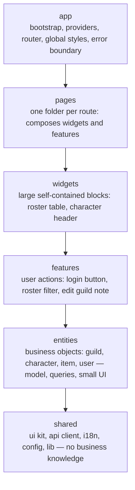

# Frontend architecture (`apps/web`)

`apps/web` does not exist yet. The framework choice (React or Angular) is open in [decision 0006](../decisions/0006-frontend-framework.md). The rules below hold for either choice. Section 8 maps them to each framework.

The web app is a static single-page app built by Vite (React) or the Angular CLI (which builds with Vite and esbuild). It is served by Caddy on the same origin as the API.

## 1. Layers

The structure follows Feature-Sliced Design. Layers are ordered; a layer may import only from layers **below** it.



| Layer      | Contains                                                                                 | May import                                        |
| ---------- | ---------------------------------------------------------------------------------------- | ------------------------------------------------- |
| `app`      | Entry point, providers (query client, i18n, theme), router setup, root error boundary    | All layers                                        |
| `pages`    | One slice per route. Reads route params, composes widgets, sets the document title       | `widgets`, `features`, `entities`, `shared`       |
| `widgets`  | Composite blocks used by pages (`roster-table`, `character-equipment`)                   | `features`, `entities`, `shared`                  |
| `features` | One user interaction each, with its UI, state, and the mutation it triggers              | `entities`, `shared`                              |
| `entities` | Domain types (from contracts), query definitions, formatting, small presentational parts | `shared`                                          |
| `shared`   | UI kit (buttons, dialogs, tooltips), API client, i18n setup, design tokens, utilities    | Nothing from the layers above; external libraries |

Rules:

- **Slices on the same layer do not import each other.** `features/login` never imports `features/roster-filter`. Shared needs move one layer down.
- **Each slice exposes one public `index.ts`.** Imports from outside the slice go through it (`@/entities/character`, never `@/entities/character/model/map.ts`).
- **Segments inside a slice:** `ui/` (components), `model/` (state, hooks or services, types), `api/` (query and mutation definitions), `lib/` (pure helpers). A slice has only the segments it needs.
- `shared` knows nothing about guilds or characters. If a component mentions a character, it belongs in `entities` or above.
- `dependency-cruiser` (or `eslint-plugin-boundaries`) enforces these rules in `pnpm verify`.

## 2. Folder structure

```text
apps/web/
  src/
    app/
    pages/
      guild/             /            hero + roster
      character/         /characters/:slug
      me/                /me          own characters (needs login)
      not-found/
    widgets/
    features/
    entities/
      guild/
      character/
      item/
      user/
    shared/
      api/               generated or typed client, ApiError, problem parsing
      ui/                design-system components
      i18n/              locales/de.json, locales/en.json
      config/            instance config loading (from GET /api/instance)
      lib/
  e2e/                   Playwright tests
  public/
```

## 3. Data and state

- **Server state** (anything from the API) lives only in the query cache (TanStack Query for React, TanStack Query Angular or `httpResource` for Angular). Components never copy server data into their own state.
- **URL state** (filters, sort, selected tab) lives in the URL. A reloaded or shared link shows the same view.
- **Local UI state** (open dialog, hover) lives in the component.
- **Global client state** is the exception. It needs a reason (for example the theme); then one small store per concern.
- Query keys are defined once per entity in `entities/<x>/api/keys.ts`. Mutations invalidate the keys they affect.

## 4. API access

- The only way to call the API is the client in `shared/api`. Components and hooks never call `fetch` directly.
- Request and response types come from `packages/contracts` (the same zod schemas the API validates with). Responses are parsed in development and test builds to catch contract drift; production trusts the types to save work.
- The client sends cookies (`credentials: "same-origin"`), sets `Accept: application/json`, and attaches no tokens. The browser never sees an OAuth token.
- Errors follow the [error model](errors.md): every failure becomes an `ApiError` with a `code`.
- Login is a full-page navigation to `/auth/login?returnTo=<path>`. Logout is a `POST /auth/logout` followed by clearing the query cache.

## 5. Instance configuration and theming

- At startup the app loads `GET /api/instance` (name, region, guild slug, logo URL, copy, theme tokens) and renders nothing guild-specific before that.
- Theme values are CSS custom properties (design tokens: `--color-brand`, `--font-display`, ...), set on `:root` from the instance theme. Components use only tokens, never literal brand colours.
- Copy (hero text) comes from the instance in each supported locale.

## 6. UI rules

- **Accessibility:** WCAG 2.2 level AA. Semantic HTML first; ARIA only where HTML has no element. Every interactive element works with the keyboard and has a visible focus. Item tooltips open on hover **and** on focus, and close with `Escape`.
- **Internationalisation:** locales `de` and `en` (BCP 47 tags). Dates, numbers, and relative times are formatted with `Intl`, in the user's locale and time zone. No user-visible string is hard-coded in a component.
- **Loading:** skeletons for content areas, never full-page spinners after the first paint. Show cached data while refetching.
- **Images:** character renders and item icons come from Battle.net media URLs via the API, with fixed width and height to avoid layout shift, and lazy loading below the fold.
- **Performance budgets:** LCP ≤ 2.5 s, INP ≤ 200 ms, CLS ≤ 0.1 on a mid-range phone. Route-level code splitting. Initial JavaScript ≤ 200 kB compressed.
- **Security:** no `dangerouslySetInnerHTML` / `[innerHTML]` with API data. External scripts (for example Wowhead tooltips) only from hosts allowed by the CSP.

## 7. Testing

| Level         | What                                                          | How                                                          |
| ------------- | ------------------------------------------------------------- | ------------------------------------------------------------ |
| Unit          | `lib/` helpers, formatting, model logic                       | Vitest                                                       |
| Component     | Slices in isolation, all states (loading, empty, error, data) | Vitest + Testing Library, API mocked with MSW                |
| End to end    | Journeys: open guild page, open character, log in, see "Me"   | Playwright against the Aspire stack with the Battle.net stub |
| Accessibility | Each page in E2E                                              | `@axe-core/playwright`, zero violations at level AA          |

Every component test covers the error state for at least one `ApiError` code.

## 8. Framework mapping

| Concept         | React (recommended)                           | Angular                                                                    |
| --------------- | --------------------------------------------- | -------------------------------------------------------------------------- |
| Build           | Vite                                          | Angular CLI (application builder)                                          |
| Routing         | TanStack Router (type-safe params, loaders)   | Angular Router with lazy routes                                            |
| Server state    | TanStack Query                                | TanStack Query Angular or `httpResource`                                   |
| Local state     | `useState` / `useReducer`                     | Signals                                                                    |
| API client      | `shared/api` functions over `fetch`           | `shared/api` services over `HttpClient`, problem parsing in an interceptor |
| Error boundary  | Route `errorComponent` + React error boundary | Route-level error component + `ErrorHandler`                               |
| Forms           | TanStack Form or React Hook Form with zod     | Typed reactive forms, zod validation in a validator                        |
| Component tests | Testing Library React                         | Testing Library Angular                                                    |
