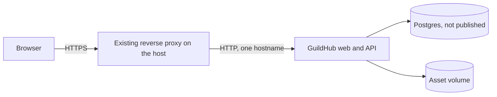

# Deployment

How GuildHub will be deployed. Not built yet. Build the first version without this. The shape is fixed so the application and the Compose file do not have to be redesigned when CD is added.

Decision: [0009](decisions/0009-deploy-behind-existing-proxy.md). Images, tags, secrets, and backups stay as in [0007](decisions/0007-deployment-compose-linux.md).

## 1. What the server already is

One Linux host. Docker is running. Two or three other sites are already published through whatever reverse proxy that host uses (Caddy, nginx, Traefik, or similar). Public 80 and 443 belong to that proxy. GuildHub does not bind them and does not replace the proxy.

## 2. What GuildHub provides

HTTP only. One internal port for the site. Postgres, the asset volume, and the baker's files stay on a Docker network that is not published to the host.

The proxy routes by path on a single hostname:

| Path            | Goes to                       |
| --------------- | ----------------------------- |
| `/api`, `/auth` | API container                 |
| `/assets`       | asset volume, immutable cache |
| everything else | web assets                    |

One hostname is required. The session cookie is `SameSite=Lax` and has no `Domain`, and the web app calls the API on the same origin. A split like `api.example.com` plus `www.example.com` breaks that. TLS for that hostname is the proxy's certificate, the one it already uses for the other sites. GuildHub stores no certificate and runs no ACME client.

The API is told its public URL with `PUBLIC_ORIGIN=https://<hostname>` and trusts `X-Forwarded-Proto` from the proxy, so redirects and the `Secure` cookie match what the browser sees. The Battle.net redirect URI is that origin plus `/auth/callback`.

Two ways to attach, picked to match the proxy that is already there:

- **Preferred:** both join an external Docker network. The proxy reaches the containers by name. No host port.
- **Otherwise:** GuildHub publishes `127.0.0.1:<port>` only. The proxy uses `localhost`. The port is not reachable from outside the machine.

Postgres is never given a host port.

## 3. What a deploy does

CI already runs `verify` on every push. CD is a later workflow, on `main`, and only after that workflow is green.

1. Build the images for the server's architecture (amd64 until the host says otherwise). Tag them with the full commit SHA. Push them to GHCR.
2. SSH to the server as the deploy user. The private key is a GitHub Actions secret. The user has no password and no shell beyond the deploy script.
3. The script writes the SHA into the server's Compose env, pulls those tags, runs the one-shot `migrate` container, and on success runs `docker compose up -d`. A failed migration does not restart the running app.
4. The script curls the app's health through the local port. A failure exits non-zero so the workflow is red. It does not roll forward past a bad health check.
5. Rollback is the same script with the previous SHA.

A deploy does not run the model baker, does not download game files, and does not renew certificates. The asset volume and the Postgres volume survive the deploy. See [when the baker runs](architecture/character-rendering-plan.md).

Secrets (`BATTLENET_CLIENT_SECRET`, `SESSION_SECRET`, the database password) live only in the server's `.env`, mode 600, owner root. They are not GitHub secrets. The only GitHub secrets for deploy are the SSH key and, if GHCR is private, a read token for the deploy user.

Every container writes structured logs to stdout. Docker's configured log driver handles retention.
No OpenTelemetry collector or vendor sink ships with the first deployment. If the host later gains
one, set `OTEL_EXPORTER_OTLP_ENDPOINT` and the standard resource attributes; the application images
already export traces and metrics. A missing sink never affects health.

## 4. How the server is opened

Nothing new is exposed to the internet.

- Ports 80 and 443 stay with the existing proxy.
- The Docker API stays on its local socket. It is not published and not tunnelled.
- SSH is the door CI uses. The deploy user's `authorized_keys` entry has a `command=` restriction that runs only the deploy script, so the key cannot be used as a shell. The key is unique to this repo's deploy workflow.
- If port 22 is not reachable from GitHub's runners, the SSH goes over Tailscale (or the equivalent already on the machine) instead of opening 22 to the internet. A self-hosted runner is the fallback if SSH from outside is unwanted. It is not the default: a runner on the Docker host can do more than deploy.

The first time, a person with access to the host does four things by hand: create the deploy user, create the directory and the `.env`, add the proxy vhost for the hostname, and confirm a manual `docker compose up` of a pinned SHA. CD automates only the pull and the restart after that.

## 5. What we are not doing

- No Kubernetes.
- No Watchtower and no `:latest` auto-pull. A deploy is a chosen SHA that passed `verify`.
- No second Let's Encrypt inside GuildHub, unless the host turns out to have no proxy. That discovery happens at the first manual deploy, and only then would a Caddy container be added in front of the same HTTP services.
- No CD workflow, no server change, and no DNS change until the first version exists.
