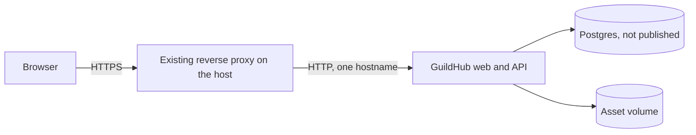

# Deployment

How GuildHub is deployed. The step-by-step setup, rollback, backups, and troubleshooting are in the [deploy runbook](operations/deploy-runbook.md). The files are [`deploy/compose.prod.yaml`](../deploy/compose.prod.yaml), [`deploy/server/`](../deploy/server), and [`.github/workflows/deploy.yml`](../.github/workflows/deploy.yml).

Decision: [0009](decisions/0009-deploy-behind-existing-proxy.md). Images, tags, secrets, and backups stay as in [0007](decisions/0007-deployment-compose-linux.md).

## 1. What the server already is

One Linux host. Docker is running. Two or three other sites are already published through whatever reverse proxy that host uses (Caddy, nginx, Traefik, or similar). Public 80 and 443 belong to that proxy. GuildHub does not bind them and does not replace the proxy.

## 2. What GuildHub provides

HTTP only. One internal port for the site. Postgres, the asset volume, and the baker's files stay on a Docker network that is not published to the host.

The proxy sends the whole hostname to the `web` container. Caddy in that container routes by path:

| Path            | Goes to                                                                                 |
| --------------- | --------------------------------------------------------------------------------------- |
| `/api`, `/auth` | API container                                                                           |
| `/assets`       | asset volume: immutable cache; bosses and maps revalidate; a missing file is not cached |
| everything else | web assets                                                                              |

One hostname is required. The session cookie is `SameSite=Lax` and has no `Domain`, and the web app calls the API on the same origin. A split like `api.example.com` plus `www.example.com` breaks that. TLS for that hostname is the proxy's certificate, the one it already uses for the other sites. GuildHub stores no certificate and runs no ACME client.

The API is told its public URL with `PUBLIC_ORIGIN=https://<hostname>` and trusts `X-Forwarded-Proto` from the proxy, so redirects and the `Secure` cookie match what the browser sees. The Battle.net redirect URI is that origin plus `/auth/callback`.

Ways to attach, picked to match the proxy that is already there:

- **Built:** Traefik with the Docker provider. The `web` service carries the router labels (hostname, entrypoint, certificate resolver, port 8080). With Traefik on the host network it reaches the container on GuildHub's own network. No host port.
- **Traefik on a bridge network:** `web` also joins that network as an external network, plus `traefik.docker.network`.
- **Another proxy:** GuildHub publishes `127.0.0.1:<port>` only. The proxy uses `localhost`. The port is not reachable from outside the machine.

Postgres is never given a host port.

## 3. What a deploy does

CI runs `verify` on every push. The `deploy` workflow runs on `main`, and only after `verify` is green for a push to this repository.

1. Build `api`, `worker`, and `web` for amd64. Tag them with the full commit SHA. Push them to GHCR.
2. SSH to the server as the deploy user, with the SHA as the command and `deploy/compose.prod.yaml` on standard input. The private key is a GitHub environment secret. `authorized_keys` forces the key to run the deploy script and nothing else.
3. The script stores the compose file, pulls those tags, runs the one-shot `migrate` container, and on success runs `docker compose up -d`. A failed migration does not restart the running app.
4. The script checks the API's readiness, the web container, and the worker inside the containers. A failure starts the previous SHA again and exits non-zero, so the workflow is red. Only a healthy deploy writes its SHA into the server's `.env`.
5. Rollback is the same workflow, started by hand with an earlier SHA. It skips the build.

A deploy does not run the model baker, does not download game files, and does not renew certificates. The asset volume and the Postgres volume survive the deploy. See [when the baker runs](architecture/character-rendering-plan.md).

Secrets (`BATTLENET_CLIENT_SECRET`, `SESSION_SECRET`, the database password) live only on the server, in `.env` and `app.env`, mode 600, owned by the deploy user. They are not GitHub secrets. GitHub holds only the deploy key, the server's address, and its pinned host key. If the GHCR images stay private, the server holds a read token for them.

The repository is public. It names no server, hostname, or directory; those exist only on the server and in the GitHub environment.

Every container writes structured logs to stdout. Docker's configured log driver handles retention.
No OpenTelemetry collector or vendor sink ships with the first deployment. If the host later gains
one, set `OTEL_EXPORTER_OTLP_ENDPOINT` and the standard resource attributes; the application images
already export traces and metrics. A missing sink never affects health.

## 4. How the server is opened

Nothing new is exposed to the internet.

- Ports 80 and 443 stay with the existing proxy.
- The Docker API stays on its local socket. It is not published and not tunnelled.
- SSH is the door CI uses. The deploy user's `authorized_keys` entry has a `command=` restriction that runs only the deploy script, so the key cannot be used as a shell. The key is unique to this repo's deploy workflow.
- If port 22 is not reachable from GitHub's runners, the SSH goes over Tailscale (or the equivalent already on the machine) instead of opening 22 to the internet. A self-hosted runner is the fallback if SSH from outside is unwanted. It is not the default: a runner on the Docker host can do more than deploy.

The first time, a person with root on the host does the setup in the [runbook](operations/deploy-runbook.md#3-one-time-setup-on-the-server): the deploy user, the directory with `.env` and `app.env`, the two scripts, the restricted key, and the backup cron. The proxy needs no change; the router comes from the labels. CD automates everything after that.

## 5. What we are not doing

- No Kubernetes.
- No Watchtower and no `:latest` auto-pull. A deploy is a chosen SHA that passed `verify`.
- No second Let's Encrypt inside GuildHub, unless the host turns out to have no proxy. That discovery happens at the first manual deploy, and only then would a Caddy container be added in front of the same HTTP services.
- No automatic update of the server scripts. They are installed by hand and owned by root, so a deploy cannot change what the deploy key is allowed to run.
