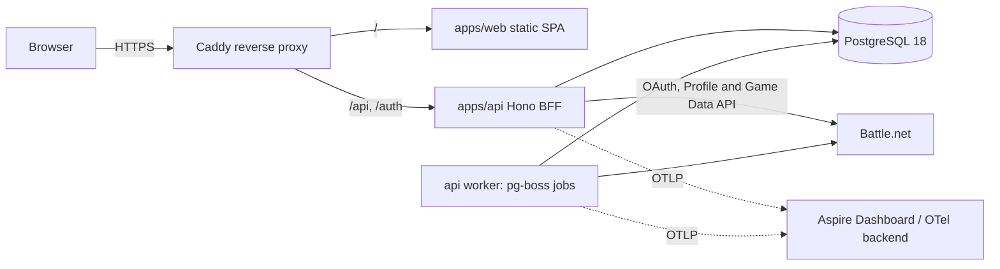

# GuildHub North Star

This is the target picture for GuildHub. It is binding: code, reviews, and agents follow it. When reality must deviate, change this document first (or write a decision record), then change the code.

Each section says what exists **today** and what the **target** is. Nothing here claims to be built unless it says so.

Detailed rules live in:

- [Backend architecture](architecture/backend.md)
- [Frontend architecture](architecture/frontend.md)
- [Error model](architecture/errors.md) (shared by backend and frontend)
- [Development, local stack, and agents](development.md)
- [Standards register](standards.md)
- [Decision records](decisions/)

## 1. What GuildHub is

GuildHub is a website platform for a World of Warcraft: Forever guild. One deployment serves one guild. The guild comes from an instance configuration (region, guild slug, name, logo, copy, theme), not from code.

Traceless (`eu` / `traceless`) is the first instance. Nothing in `apps/` or `packages/` may name Traceless. Only `instances/traceless/` does.

Core features (target):

1. Public guild page: hero, branding, and the guild roster with ranks.
2. Character pages: equipment with item tooltips on hover, stats, and the official character render.
3. Login with Battle.net (official OAuth). There is no own password login.
4. "Me" page: the user's own WoW: Forever characters, taken from the Battle.net account.
5. Guild extensions that Battle.net does not provide (for example notes, events, rank names). These are stored in our database.

Non-goals: no own account system, no scraping of the Armory website (the Battle.net API is the source), no multi-tenant hosting of many guilds in one process.

## 2. Principles

These decide conflicts. Earlier principles win over later ones.

1. **Security and privacy first.** The Battle.net client secret, OAuth tokens, and session secrets never reach the browser, the image, or the repository. We store only the user data we need.
2. **The official source is truth.** Battle.net data is read from the Battle.net API through `@blizzard-api/wow-forever`. Our database caches it and adds our own data. It never invents Battle.net data.
3. **Boundaries are explicit and enforced.** Layers and modules have import rules (see the architecture documents). Tooling enforces them in `pnpm verify`; review does not have to catch them.
4. **One way to do each thing.** One command for local start, one for verification, one error format, one way to call the API from the frontend.
5. **Runs locally without secrets.** The full stack, including login, runs against a Battle.net stub. Developers and agents need no real credentials for day-to-day work.
6. **Observable by default.** Every request has a trace. Logs are structured and correlated to it. Humans and agents read the same data.
7. **Boring, current technology.** We pick maintained, mainstream tools. We do not pin to outdated majors, and we do not run release candidates without a decision record.

## 3. System overview (target)



- `apps/web` is a static single-page app. It talks only to `apps/api`, on the same origin.
- `apps/api` is a backend-for-frontend (BFF). It owns the Battle.net login, the session cookie, all Battle.net calls, and our database.
- A worker process (same codebase as the API, different entry point) refreshes Battle.net data through jobs stored in Postgres (pg-boss). There is no Redis.
- Caddy terminates TLS (automatic Let's Encrypt) and routes by path. Because web and API share one origin, there is no CORS and the session cookie stays `SameSite=Lax`.

Today: only `apps/api` exists, with `GET /health`.

## 4. Repository layout (target)

```text
apphost/              Aspire TypeScript AppHost: the local stack and the deployment model
apps/
  api/                Hono BFF + worker entry point
  web/                Frontend SPA
  battlenet-stub/     Fake Battle.net (OAuth + API) for local runs, E2E, and agents
packages/
  contracts/          Zod schemas for HTTP requests/responses, problem codes, instance config schema
  tsconfig/           Shared TypeScript configs (when a second package needs them)
instances/
  traceless/          instance.json + assets (logo, hero image) for the Traceless deployment
docs/                 This document and the rules
```

Rules:

- `apps/*` are deployable. They never import from each other.
- `packages/*` are libraries. `apps/web` and `apps/api` both use `packages/contracts`. `contracts` depends only on `zod`.
- `instances/*` is data, validated against the schema in `packages/contracts` at API startup. The web app receives it via `GET /api/instance`.

Today: `apps/api` only. The other folders are created when their first code lands.

## 5. Technology decisions

| Area                | Decision                                                          | Record                                                  |
| ------------------- | ----------------------------------------------------------------- | ------------------------------------------------------- |
| Runtime             | Node 24 LTS, TypeScript strict, ESM                               | —                                                       |
| Package manager     | pnpm 10 workspace, catalog for shared versions, 3-day release age | —                                                       |
| API framework       | Hono on `@hono/node-server`                                       | [0001](decisions/0001-hono-bff.md)                      |
| Local orchestration | Aspire with a TypeScript AppHost                                  | [0002](decisions/0002-aspire-local-orchestration.md)    |
| Database            | PostgreSQL 18, Drizzle ORM, SQL migrations in the repo            | [0003](decisions/0003-postgres-drizzle.md)              |
| Jobs                | pg-boss on the same Postgres                                      | [0003](decisions/0003-postgres-drizzle.md)              |
| Errors              | RFC 9457 Problem Details with stable error codes                  | [0004](decisions/0004-problem-details.md)               |
| Auth                | Battle.net OAuth via `arctic`, server-side sessions in Postgres   | [0005](decisions/0005-battlenet-oauth-bff-sessions.md)  |
| Frontend            | Open: React (recommended) or Angular                              | [0006](decisions/0006-frontend-framework.md) (proposed) |
| Observability       | OpenTelemetry SDK, pino logs, Aspire Dashboard                    | [0002](decisions/0002-aspire-local-orchestration.md)    |
| Deployment          | Linux server, Docker Compose generated by `aspire publish`, Caddy | [0007](decisions/0007-deployment-compose-linux.md)      |

## 6. Data

### 6.1 What lives where

| Data                                             | Source of truth                | Stored by us                                     |
| ------------------------------------------------ | ------------------------------ | ------------------------------------------------ |
| Guild profile, roster, ranks (rank IDs)          | Battle.net Profile API         | Cached snapshot with `fetched_at`                |
| Character profile, equipment, stats, media       | Battle.net Profile API         | Cached snapshot with `fetched_at`                |
| Items, media of items                            | Battle.net Game Data API       | Cached, long TTL                                 |
| User identity (Battle.net account ID, BattleTag) | Battle.net OAuth               | `users` row                                      |
| User's own characters                            | Battle.net `/profile/user/wow` | Link table, refreshed on login                   |
| Sessions                                         | GuildHub                       | `sessions` row, only a hash of the session token |
| Guild extensions (rank names, notes, events)     | GuildHub                       | Own tables                                       |
| Instance configuration                           | `instances/<slug>/`            | Not in the database                              |

OAuth access tokens of users are kept only as long as a request flow needs them. If a feature needs them later (for example to refresh the "Me" page), they are stored encrypted at rest, with a decision record.

### 6.2 Database rules

- PostgreSQL 18 locally (Aspire container) and in production (container on the server with a named volume).
- Every schema change is a reviewed SQL migration in `apps/api/drizzle/`, generated by `drizzle-kit generate` and committed. No `push` against shared or production databases.
- Migrations run as their own step (`migrate` resource locally, one-shot container in production) before the API starts. The API never migrates on boot.
- Each backend module owns its tables (prefix or Postgres schema per module). Another module never reads or writes them directly; it calls the owning module's public API.
- Timestamps are `timestamptz` in UTC. IDs are UUIDv7 (`uuidv7()` is built into PostgreSQL 18). Battle.net IDs are stored as they are, in their own columns.
- Backups in production: nightly `pg_dump` to storage outside the server, with a restore test before each major version upgrade.

## 7. Battle.net integration

- Namespaces: `profile-forever-eu`, `static-forever-eu`, `dynamic-forever-eu`, host `eu.api.blizzard.com`. Region and namespaces come from the instance config.
- App token (client credentials) for public profile and game data. User token (authorization code, scope `openid wow.profile`) only for the user's own account data.
- All calls go through one adapter in `apps/api` (module infrastructure). It handles token caching, retries with backoff on 429/5xx, the rate limit (36,000 requests per hour, 100 per second per client), and maps responses to our domain types.
- Known gaps: characters below level 10 have no profile (404). The roster carries rank IDs only (0 is guild master), so rank names are our extension. Hunter pets and Mythic Keystone endpoints return 404 for Forever.
- Data is refreshed by jobs (roster every few hours, characters on demand with a freshness window), not on every page view.

## 8. Security baseline

- OWASP ASVS 5.0 Level 2 is the reference for the API and web app.
- Session cookie: `__Host-gh_session`, `HttpOnly`, `Secure`, `SameSite=Lax`, `Path=/`, no `Domain`. Rotated on login, invalidated on logout, idle and absolute timeouts.
- State-changing requests require a same-origin `Origin` header (CSRF defence in addition to `SameSite`).
- Strict Content Security Policy from the API/proxy. External scripts (for example item tooltips) are allowed only by explicit host entries.
- Secrets come only from the environment (locally from Aspire parameters / user secrets, in production from the server's `.env` with mode 600). The CI secret scan (gitleaks) must stay green.
- Containers run as non-root, read-only filesystem, all capabilities dropped.

## 9. Quality targets

GuildHub uses the ISO/IEC 25010 quality model to name what matters, in this order:

1. **Security** (see section 8).
2. **Reliability:** Battle.net outages degrade to cached data with a visible "last updated" time. They do not cause errors.
3. **Maintainability:** enforced layer rules, tests for each use case, no file over roughly 300 lines without a reason.
4. **Performance efficiency:** API p95 under 200 ms for cached reads. Web Core Web Vitals "good" (LCP ≤ 2.5 s, INP ≤ 200 ms, CLS ≤ 0.1).
5. **Usability and accessibility:** WCAG 2.2 level AA.

## 10. Delivery

- Every change goes through `pnpm verify` locally and the `verify` workflow in CI.
- `main` is always deployable. Images are built once in CI, tagged with the commit SHA, pushed to GHCR, and deployed by tag.
- Dependencies are updated by Dependabot in groups, after a 3-day cooldown.

## 11. Roadmap

1. Enforce layer and module boundaries with `dependency-cruiser` in `pnpm verify`.
2. Add `packages/contracts` with the problem model and the instance config schema; add `instances/traceless`.
3. Add the Aspire AppHost with Postgres, the API, the migrator, and the Battle.net stub. Replace `compose.yaml` with `aspire publish` output.
4. Add OpenTelemetry and pino to the API; split `/health` into `/health/live` and `/health/ready`.
5. Guild module: roster from Battle.net, cached, `GET /api/guild` and `GET /api/guild/roster`.
6. Decide the frontend framework (record 0006), scaffold `apps/web`, build the guild page.
7. Identity module: Battle.net login, sessions, `GET /api/me`.
8. Character module and pages, then guild extensions.
9. Production server: Caddy, backups, deployment workflow.
