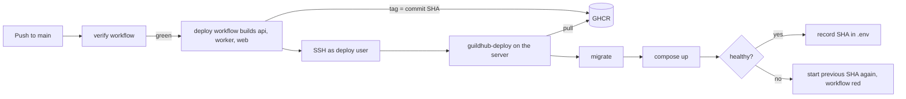

# Deploy runbook

How to put GuildHub on a Linux server once, and how every deploy after that works. The why is in [deployment](../deployment.md) and decisions [0007](../decisions/0007-deployment-compose-linux.md) and [0009](../decisions/0009-deploy-behind-existing-proxy.md).

This repository is public. Nothing in it names a real server. Every value that belongs to one installation is a placeholder here and lives only on the server or in the GitHub environment:

| Placeholder     | Meaning                                                | Example                         |
| --------------- | ------------------------------------------------------ | ------------------------------- |
| `<server>`      | SSH hostname or IP of the Docker host                  | `host.example.com`              |
| `<deploy-dir>`  | Directory on the server that holds this installation   | `/opt/docker/services/guildhub` |
| `<site-host>`   | Public hostname of the site                            | `guild.example.com`             |
| `<instance>`    | Directory under `instances/` the images are built with | `my-guild`                      |
| `<owner>`       | GitHub owner of the repository, in lower case          | `someone`                       |
| `<deploy-user>` | Linux user that runs deploys                           | `guildhub-deploy`               |

## 1. How a deploy works



1. A push to `main` runs `verify`. Only a green `verify` on a push to this repository starts `deploy`. Pull requests and forks never deploy.
2. `deploy` builds three images for `linux/amd64` and pushes them as `ghcr.io/<owner>/guildhub-{api,worker,web}:<sha>`.
3. It opens SSH to `<server>` as `<deploy-user>`, sends the full SHA as the command and `deploy/compose.prod.yaml` on standard input.
4. The server's `authorized_keys` forces that key to run `/usr/local/bin/guildhub-deploy <deploy-dir>` and nothing else.
5. The script stores the compose file as `<deploy-dir>/compose.yaml`, pulls the images, runs the database migration, and starts the stack.
6. It waits for the API to be healthy and ready (database reachable, migrations applied), for the web container to serve `/`, and for the worker to run.
7. Healthy: the SHA goes into `<deploy-dir>/.env` as `GUILDHUB_TAG`, older GuildHub images are removed (the previous one is kept). Not healthy: the previous SHA is started again and the workflow fails.

A deploy never runs the model baker by hand and never touches the volumes. Character models are baked by the worker when a page first needs them, from Blizzard's CDN, into the `assets` volume. They are never in git.

What runs on the server, all in one Compose project named `guildhub-<instance>`:

| Service    | Job                                                           | Memory limit |
| ---------- | ------------------------------------------------------------- | ------------ |
| `web`      | Caddy: the site, `/assets`, proxies `/api` and `/auth` to api | 96 MB        |
| `api`      | Node API                                                      | 256 MB       |
| `worker`   | Jobs: guild history, recipe catalog, model baker              | 768 MB       |
| `postgres` | Database, volume `postgres`                                   | 256 MB       |
| `migrate`  | One-shot schema migration, only during a deploy               | 256 MB       |

Only `web` is reachable, through the host's Traefik. No GuildHub container publishes a port. Every container has `oom_score_adj: 500`, so if the host runs out of memory the kernel stops GuildHub before the host's other services.

## 2. What the server needs

- Linux on amd64 with Docker Engine and the Compose plugin (`docker compose version`).
- Traefik on the host with the Docker provider, `exposedByDefault: false`, an HTTPS entrypoint, and an ACME certificate resolver. The defaults in the compose file are entrypoint `websecure` and resolver `letsencrypt`. Read the real names from Traefik's static configuration and set them in `.env` if they differ.
- A DNS record for `<site-host>` that points at the server.
- About 4 GB free disk for images, the database, baked models, and the baker cache.
- At least 1 GB RAM. With exactly 1 GB, add swap (section 3.7).
- SSH reachable from GitHub's runners on the port you configure.

If Traefik runs with `network_mode: host`, it reaches the web container on the project's own network and no shared network is needed. If Traefik runs on a bridge network instead, add that network to the `web` service as an external network and the label `traefik.docker.network=<that network>`.

## 3. One-time setup on the server

Run as root on `<server>`.

### 3.1 Deploy user

```bash
useradd --create-home --shell /bin/bash <deploy-user>
usermod --append --groups docker <deploy-user>
passwd --lock <deploy-user>
```

Membership in the `docker` group is equivalent to root on that host. The deploy key is therefore limited to one command (3.4), has no password, and exists only for this repository's workflow.

### 3.2 Directory and configuration

```bash
install -d -m 750 -o <deploy-user> -g <deploy-user> <deploy-dir>
cd <deploy-dir>
```

Create `.env` from [`deploy/env/compose.env.example`](../../deploy/env/compose.env.example) and `app.env` from [`deploy/env/app.env.example`](../../deploy/env/app.env.example). Fill in:

- `.env`: `GUILDHUB_INSTANCE=<instance>`, `GUILDHUB_IMAGE_PREFIX=ghcr.io/<owner>/guildhub`, `PUBLIC_HOST=<site-host>`, `POSTGRES_PASSWORD` from `openssl rand -hex 32`. Leave `GUILDHUB_TAG` empty.
- `app.env`: the Battle.net client ID and secret (section 4), `BATTLENET_REDIRECT_URI=https://<site-host>/auth/callback`, `SESSION_SECRET` from `openssl rand -hex 32`.

```bash
chown <deploy-user>:<deploy-user> .env app.env
chmod 600 .env app.env
```

These two files are the only place the secrets exist. They are not in git, not in GitHub, and not in any image. Keep a copy in a password manager.

### 3.3 Scripts

Copy the two scripts from a checkout of this repository, from your own machine:

```bash
scp deploy/server/guildhub-deploy.sh deploy/server/guildhub-backup.sh root@<server>:/tmp/
```

Then on the server:

```bash
install -m 755 -o root -g root /tmp/guildhub-deploy.sh /usr/local/bin/guildhub-deploy
install -m 755 -o root -g root /tmp/guildhub-backup.sh /usr/local/bin/guildhub-backup
rm /tmp/guildhub-deploy.sh /tmp/guildhub-backup.sh
```

The deploy user can run them but cannot change them. When a script changes in the repository, repeat this step. A deploy does not update them.

### 3.4 Deploy key

Make a new key pair for this purpose only, on your own machine, without a passphrase:

```bash
ssh-keygen -t ed25519 -N "" -C "guildhub-deploy" -f guildhub_deploy
```

On the server, give the public key exactly one command:

```bash
install -d -m 700 -o <deploy-user> -g <deploy-user> /home/<deploy-user>/.ssh
echo 'restrict,command="/usr/local/bin/guildhub-deploy <deploy-dir>" <contents of guildhub_deploy.pub>' \
  >> /home/<deploy-user>/.ssh/authorized_keys
chown <deploy-user>:<deploy-user> /home/<deploy-user>/.ssh/authorized_keys
chmod 600 /home/<deploy-user>/.ssh/authorized_keys
```

`restrict` turns off port forwarding, agent forwarding, and the terminal. `command=` ignores whatever the client asks to run and passes it to the script as `SSH_ORIGINAL_COMMAND`, which the script only accepts as a 40-character SHA.

The private key `guildhub_deploy` goes into GitHub (section 5) and is then deleted from your machine.

### 3.5 Image access

GHCR packages start private. Pick one:

- **Public images (simplest for a public repository).** After the first `deploy` run, open each of `guildhub-api`, `guildhub-worker`, `guildhub-web` under the owner's Packages, Package settings, and set visibility to public. The server then pulls without logging in.
- **Private images.** Create a classic personal access token with only `read:packages`. On the server, as the deploy user:

  ```bash
  sudo -u <deploy-user> docker login ghcr.io --username <github-user>
  ```

  Paste the token as the password. It is stored in `/home/<deploy-user>/.docker/config.json`.

### 3.6 Nightly backup

```bash
echo '30 3 * * * root /usr/local/bin/guildhub-backup <deploy-dir> /var/backups/guildhub 14 >/dev/null' \
  > /etc/cron.d/guildhub-backup
```

That keeps 14 days of `pg_dump` files in `/var/backups/guildhub`. They are on the same disk as the database. Copy them off the host now and then (for example `scp` to your machine); a disk failure takes both.

The `assets` and `baker-cache` volumes are not backed up. The worker rebuilds them.

### 3.7 Swap on a small host

Only if the host has about 1 GB RAM and no swap:

```bash
fallocate -l 2G /swapfile && chmod 600 /swapfile && mkswap /swapfile && swapon /swapfile
echo '/swapfile none swap sw 0 0' >> /etc/fstab
echo 'vm.swappiness=10' > /etc/sysctl.d/99-swappiness.conf && sysctl -p /etc/sysctl.d/99-swappiness.conf
```

## 4. Battle.net client

On [develop.battle.net](https://develop.battle.net/access/clients) create a client (or use the existing one). Add `https://<site-host>/auth/callback` as a redirect URL. Its ID and secret go into `app.env` only.

## 5. GitHub configuration

In the repository, Settings, Environments, create `production`. Optionally restrict it to the `main` branch and add yourself as a required reviewer if every deploy should wait for a click.

Environment secrets in `production`:

| Secret               | Value                                                                                 |
| -------------------- | ------------------------------------------------------------------------------------- |
| `DEPLOY_HOST`        | `<server>`                                                                            |
| `DEPLOY_PORT`        | SSH port, only if not 22                                                              |
| `DEPLOY_USER`        | `<deploy-user>`                                                                       |
| `DEPLOY_SSH_KEY`     | Contents of the private key `guildhub_deploy`, including the BEGIN/END lines          |
| `DEPLOY_KNOWN_HOSTS` | Output of `ssh-keyscan -t ed25519 <server>`, checked against the server's fingerprint |

Check the fingerprint once on the server with `ssh-keygen -lf /etc/ssh/ssh_host_ed25519_key.pub` and compare it to `ssh-keygen -lf <file with the keyscan line>`. Without that check, a pinned host key proves nothing.

Variables:

| Variable            | Where                    | Value                                                                 |
| ------------------- | ------------------------ | --------------------------------------------------------------------- |
| `PUBLIC_URL`        | environment `production` | `https://<site-host>`, used for a final check and the link on the run |
| `GUILDHUB_INSTANCE` | repository               | `<instance>`. Defaults to the instance in this repository when unset  |

The host appears as a secret, not a variable, so the public run logs mask it. Nothing else of the server is known to GitHub.

## 6. First deploy

1. Push to `main`, or run the `deploy` workflow by hand (Actions, deploy, Run workflow, leave the SHA empty).
2. If the images stay private, do 3.5 before this run or the pull fails.
3. Watch the run. The server step prints every line of the script.
4. Open `https://<site-host>`. The first request to a new hostname waits a few seconds while Traefik fetches the certificate.

If the first run fails before the images are pullable, fix that and run the workflow again. With no previous SHA, a failed health check leaves the new containers running so their logs can be read.

## 7. Everyday use

- **Deploy:** merge or push to `main`. Nothing else.
- **Roll back:** Actions, deploy, Run workflow, paste the full SHA of an earlier successful deploy. It skips the build and deploys those images again. The list of past deploys is in `<deploy-dir>/deploys.log`.
- **Migrations are forward only.** A rollback runs the old code on the new schema. Keep migrations additive so that works.

## 8. Looking around on the server

```bash
cd <deploy-dir>
docker compose ps                          # what runs, and health
docker compose logs --tail 100 api         # or worker, web, postgres
docker compose logs -f worker              # follow, Ctrl+C to stop
tail deploys.log                           # deploy history
docker stats --no-stream                   # memory per container
```

Run a deploy by hand, for example after changing `.env`:

```bash
runuser -u <deploy-user> -- guildhub-deploy <deploy-dir> "$(sed -n 's/^GUILDHUB_TAG=//p' <deploy-dir>/.env)"
```

## 9. Restore a backup

```bash
cd <deploy-dir>
docker compose stop api worker
docker compose exec -T postgres pg_restore -U guildhub -d guildhub --clean --if-exists < /var/backups/guildhub/<file>.dump
docker compose start api worker
```

## 10. Changing secrets and access

- **Battle.net secret or session secret:** edit `app.env`, then run a deploy by hand (section 8). A new `SESSION_SECRET` signs everyone out.
- **Database password:** change it in Postgres first (`docker compose exec postgres psql -U guildhub -c "ALTER USER guildhub PASSWORD '<new>'"`), then in `.env`, then deploy by hand.
- **Deploy key:** make a new pair (3.4), replace the line in `authorized_keys` and the `DEPLOY_SSH_KEY` secret. Removing the line alone stops all deploys immediately.
- **Remove GuildHub completely:** `docker compose down --volumes` in `<deploy-dir>` deletes containers, the database, and the models. Then remove the directory, `/etc/cron.d/guildhub-backup`, the two scripts, and the deploy user.

## 11. When something fails

| Symptom                                            | Look at                                                                                    |
| -------------------------------------------------- | ------------------------------------------------------------------------------------------ |
| `Permission denied (publickey)` in the workflow    | `DEPLOY_USER`, `DEPLOY_SSH_KEY`, and the `authorized_keys` line                            |
| `Host key verification failed`                     | `DEPLOY_KNOWN_HOSTS` is stale or wrong; redo the keyscan and the fingerprint check         |
| `expected a full 40-character commit SHA`          | A rollback was started with a short SHA                                                    |
| `another deploy is running`                        | A previous run still holds the lock; wait, or check `ps aux \| grep guildhub-deploy`       |
| `unauthorized` or `denied` on pull                 | Images are private and the server is not logged in (3.5)                                   |
| `set ... in .env` from Compose                     | A variable in `.env` is missing                                                            |
| Migration fails                                    | `docker compose logs postgres`; the running version keeps running                          |
| Health check fails                                 | The logs the script prints; then `docker compose logs api`                                 |
| Site shows Traefik's 404                           | `PUBLIC_HOST`, entrypoint, and resolver names; `docker compose ps web` must show `healthy` |
| Certificate error in the browser for a few seconds | Normal on the first request; Traefik is still fetching it                                  |
| Containers restart with exit code 137              | Out of memory; `docker stats`, and the swap in 3.7                                         |
